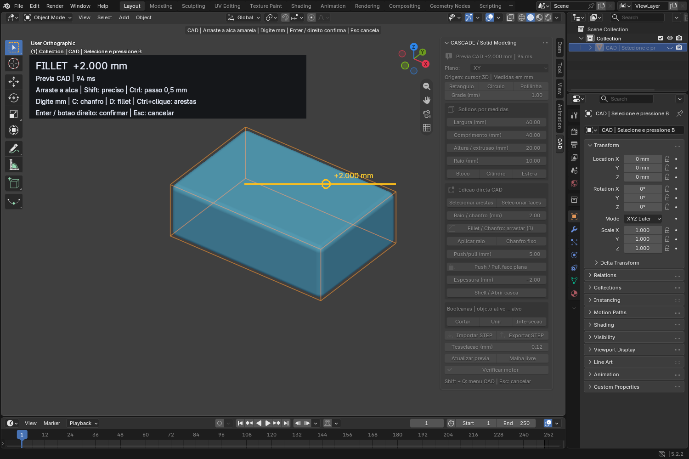

# Cascade CAD para Blender

Modelagem de sólidos CAD dentro do Blender, com **Open CASCADE** via CadQuery/OCP. Inclui fillet e chanfro por arraste com prévia no viewport, booleanas e arquivos STEP.

**[Baixar versão 0.3.0](https://github.com/GusDesign0/cascade-cad-blender/releases/tag/v0.3.0)** · [Guia do fillet interativo](docs/fillet-interativo.md)



## Novo na versão 0.3.0: remesh protegido

- **QuadWild + Bi-MDF** em processo separado, com cancelamento e prévia em wire ciano.
- Guias por limites CAD, quinas, sharp, seams, materiais e face sets.
- Validação independente de quads, manifold, ilhas, Euler, faces degeneradas e desvios amostrados em milímetros.
- **Adaptativo protegido**: tenta a retopologia; usa conversão fiel identificada no relatório quando a tentativa não passa. **QuadWild estrito**: rejeita a tentativa. **Superfície fiel**: conversão linear, sem promessa de reduzir faces.
- Aplicar cria uma nova malha e guarda o original oculto; desfazer/refazer validado no Blender.
- **[Manual ilustrado de 30 páginas (PDF)](https://github.com/GusDesign0/cascade-cad-blender/releases/download/v0.3.0/Manual_CascadeCAD_030.pdf)**: cada ferramenta, antes/depois, controles e limitações.

No viewport: **N > CAD > CASCADE / Remesh de quads**. Instale o motor opcional pelo painel (Windows x64), selecione uma malha fechada e use **Gerar prévia de quads > Aplicar**. Veja [o guia técnico](docs/remesh.md).

O motor nativo é baixado do release oficial QRemeshify 1.1.0, com SHA-256 verificado; suas DLLs não são redistribuídas no ZIP. A conversão fiel não precisa dessas DLLs. O download inicial exige internet; o processamento posterior é local. Remesh não cria BREP: resultados são malhas Blender, não sólidos exportáveis em STEP.

## Instalação no Windows

1. Na página de [releases](https://github.com/GusDesign0/cascade-cad-blender/releases/latest), baixe **CascadeCAD-0.3.0-completo.zip** e extraia para uma pasta permanente.
2. Execute **Instalar_Motor_CAD.cmd**. Ele instala Python 3.12.10, CadQuery 2.6.1 e OCP 7.8.1.1.post1 em `%LOCALAPPDATA%\CascadeCAD\runtime`, separado do Python do Blender. Não exige administrador. O primeiro download precisa de internet; depois o motor funciona offline.
3. No Blender, abra **Edit → Preferences → Get Extensions → menu → Install from Disk**, selecione **CascadeCAD-0.3.0.zip** e habilite a extensão. Algumas versões mostram essa opção no menu de **Add-ons**.
4. No viewport, pressione **N** e abra a aba **CAD**. Use **Shift+Q** para o menu rápido.

O ZIP com `completo` contém o instalador, o código, o guia e exemplos. O ZIP menor é a extensão que você instala no Blender. O download automático **Source code** do GitHub contém o projeto para desenvolvimento; ele não é o ZIP instalável.

Para experimentar sem instalar a extensão permanentemente, execute **Abrir_Demo.cmd** depois de instalar o motor. Um bloco com 12 arestas selecionadas já estará pronto: pressione **B**.

**Validado:** Blender 5.2.2 LTS, Windows x64. O manifesto permite Blender 4.2+, mas outras versões ainda não foram testadas. Linux/macOS exigem um ambiente Python/CadQuery compatível e configuração manual do executável nas preferências da extensão; o instalador fornecido é para Windows.

## Fillet com o mouse

1. Selecione um sólido Cascade CAD em **Object Mode**.
2. Clique **Selecionar arestas**, escolha as arestas ou pressione **A** para todas.
3. Pressione **B** para abrir a ferramenta.
4. Clique e arraste a **alça amarela**. Você verá a superfície CAD sendo atualizada.
5. **Enter ou botão direito** confirma. **Esc** cancela e restaura o original.

| Controle | Função |
|---|---|
| Shift ao arrastar | Ajuste dez vezes mais fino |
| Ctrl ao arrastar | Passos de 0,5 mm |
| Digitar um número | Distância exata em mm |
| C / D | Chanfro / fillet |
| Ctrl+clique numa aresta original | Adicionar ou remover da seleção |
| Ctrl+Z após confirmar | Desfazer a operação inteira |

Distância positiva gera fillet; negativa gera chanfro. Um raio inválido mantém a última prévia válida, informa o erro e impede confirmar uma geometria antiga por engano. O cálculo sempre parte do sólido original, sem acumular arredondamentos.

O motor fica carregado em um processo local e envia as superfícies para a prévia por GPU. O raio solicitado e a distância da prévia exibida aparecem no viewport enquanto o cálculo acompanha o mouse. A latência depende do modelo: um bloco simples teve mediana de aproximadamente **78 ms de cálculo** nos testes desta versão. Isso não é garantia de desempenho em peças complexas nem medida de toda a latência de interação.

## Outras ferramentas

- Perfis de retângulo, círculo e polilinha com extrusão.
- Blocos, cilindros e esferas por medidas.
- Cortar, unir e interseção entre sólidos CAD. O último objeto selecionado é o alvo ativo.
- Push/pull de faces planas e shell com faces de abertura.
- Importação e exportação STEP.
- BREP comprimido dentro do `.blend`, com desfazer/refazer do Blender.
- Cópia independente da malha para edição, escultura e modificadores.

Use as ferramentas CAD em Object Mode. Alterar a malha diretamente em Edit Mode não altera o BREP; o plugin detecta essa diferença. **Atualizar prévia** reconstrói a visualização CAD, descartando essas alterações manuais. **Malha livre** cria uma cópia independente para trabalhar como malha.

As medidas de construção são locais e em milímetros. A escala uniforme do objeto também escala esses valores no mundo; escala não uniforme, espelhamento e cisalhamento não são suportados.

## Limitações da versão 0.2

É um projeto inicial, inspirado na interação do Plasticity. **Não é uma reprodução completa nem usa o Parasolid.**

O fillet é circular e de raio constante; o chanfro usa distâncias iguais. Ainda não há perfis G2/cônicos, tensão, raio variável, limites de trecho, solver de sketch com restrições, loft, sweep ou histórico paramétrico. Operações impossíveis para a geometria podem falhar. A prévia é assíncrona e sua visualização usa tesselação; a confirmação recalcula o CAD com a tolerância final.

## Desenvolvimento e testes

O código editável está em `cascade_cad/`. O motor de prévia usa arquivos JSON locais para comunicação com um processo Python isolado. Não existe serviço em nuvem.

```text
cascade_cad/       Extensão Blender e worker Open CASCADE
tests/             Testes do motor, integração e interface
docs/              Guia de uso e captura real do Blender
validation/        Resultados da validação local da versão 0.2
tools/             Empacotamento da extensão e do pacote completo
```

Consulte [tests/README.md](tests/README.md) para reproduzir os testes. A validação local incluiu 19 verificações do motor, 19 de integração, 7 do processo de prévia, 14 de interação e 3 de ciclo de vida. Os testes de interface usam uma janela real do Blender e a API de simulação de eventos; não interaja com essa janela durante a execução.

Para gerar os ZIPs usando Python padrão:

```powershell
python tools/build_release.py
```

Os arquivos serão criados em `dist/`. O empacotador não precisa importar Blender ou CadQuery.

## Licença e referências

Extensão: **GPL-3.0-or-later**; veja [LICENSE](LICENSE). CadQuery, OCP, Open CASCADE e Python são dependências com suas próprias licenças; veja [avisos de terceiros](cascade_cad/THIRD_PARTY.md).

Projeto independente, sem vínculo com Plasticity, Siemens ou Open Cascade SAS. A referência de interação é o [manual oficial de Fillet Shell do Plasticity](https://doc.plasticity.xyz/solid/fillet-shell).


### Teste na KAIRO (Windows x64 / Blender 5.2.2 LTS)

49 peças, 951.410 quads finais; 32 peças via QuadWild (5 com refinamento) e 17 via conversão fiel protegida. Maior desvio amostrado: 0,03234 mm, com tolerância de 0,035 mm. Processamento de 211,8 segundos neste computador, uma tentativa adaptativa por peça. As 48 conexões peça/suporte foram verificadas por interseção nas malhas finais reabertas. O arquivo artístico e o relatório completo estão nos assets da release. Este é um caso de teste, não um benchmark universal.
